  <picture>
    <source media="(prefers-color-scheme: dark)" srcset="assets/hero-dark.svg">
    
  </picture>
   
  Rebuilt every day from my public commits by <a href="scripts/build_hero.py">this script</a>.

  
  
  
  

### 👋 Hi, I'm Hannes

I work on machine learning for emotion recognition and on Bayesian statistics. This is where my research code and the interactive material I teach with live.

- 🎭 **Emotion recognition:** neural networks that map facial video onto semantic emotion embeddings
- 📊 **Evaluation:** Independent Validation, a posterior for classifier accuracy instead of a point estimate
- 📐 **Teaching:** workshops on Bayesian thinking and effect sizes that run in the browser

### 🧰 Toolbox

### 📦 Things I built

| | Repo | What it does |
|---|---|---|
| 🎥 | [AFFECT](https://github.com/HannesDiemerling/AFFECT) | Facial video to semantic emotion embeddings, with models and a live webcam demo |
| 📊 | [IV-Implementation](https://github.com/HannesDiemerling/IV-Implementation) | Independent Validation: a posterior for classifier accuracy instead of a cross validation point estimate |
| 🏷️ | [emotion-labeling-software](https://github.com/HannesDiemerling/emotion-labeling-software) | Desktop apps for training raters and labeling emotions in clips |
| 🎲 | [Thinking_Bayesian](https://github.com/HannesDiemerling/Thinking_Bayesian) | Bayesian reasoning as an interactive workshop in the browser |
| 🧪 | [Frequent-Reformation](https://github.com/HannesDiemerling/Frequent-Reformation) | Hub for the Beyond p-values workshops |
| 🤖 | [ki-zum-anfassen](https://github.com/HannesDiemerling/ki-zum-anfassen) | Companion site for a hands-on AI evening |

📄 Papers

- Diemerling, H., Kulla, P., Kruse, J., & von Oertzen, T. (2026). Automated emotion recognition via video-based semantic embeddings. *Frontiers in Digital Health, 8*, 1808411. [doi:10.3389/fdgth.2026.1808411](https://doi.org/10.3389/fdgth.2026.1808411)
- von Oertzen, Thede, Diemerling, H., & von Oertzen, Timo (2026). How to use independent validation in Python. *Methodology, 22*(2), Article e18873. [doi:10.5964/meth.18873](https://doi.org/10.5964/meth.18873)
- Diemerling, H., Stresemann, L., Braun, T., & von Oertzen, T. (2024). Implementing machine learning techniques for continuous emotion prediction from uniformly segmented voice recordings. *Frontiers in Psychology, 15*, 1300996. [doi:10.3389/fpsyg.2024.1300996](https://doi.org/10.3389/fpsyg.2024.1300996)
- Diemerling, H., Kulla, P., & Kruse, J. Authentic emotion classification: A machine learning study on therapy clips. Preprint, in review. [doi:10.31219/osf.io/q9wx6](https://doi.org/10.31219/osf.io/q9wx6)

